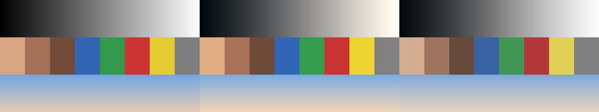
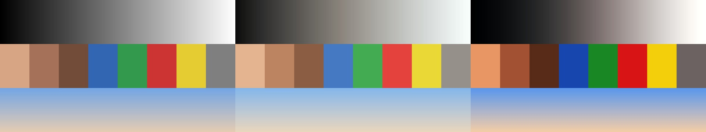
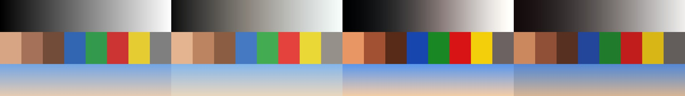

# Looks (colorización tipo cine) por formato

Estado: **candidato** (2026-10-09; probados sobre tomas reales el 2026-10-10). Datos en `looks.json`; archivos `.cube` listos para FFmpeg, DaVinci Resolve, Lightroom o CapCut (si importa LUT).

*Carta de prueba sintética: original · Cine cálido · Cine sobrio.*

*Original · Luminoso aire · Oscuro cinematográfico (edit-1).*

*Original · Luminoso aire · Oscuro cinematográfico · Burdeos cálido (edit-1).*

| Formato | Por defecto | Alternativa |
|---|---|---|
| `#edit-3-organico` | **Cine cálido** | Cine sobrio |
| `#edit-1-motion` | **Luminoso aire** | Oscuro cinematográfico (y, a pedido, **Burdeos cálido**) |
| `#edit-2`, `#edit-4-business`, `#edit-5` | pendiente (decide el usuario; para business se sugiere Cine sobrio) | pendiente |
| `#edit-6-avatar` | no aplica (fuera de la guía) | — |

## Cómo se aplica
- En la orden: `cambios: look: cine-sobrio` (o `ninguno`). Sin indicación, rige el predeterminado del formato. Intensidad: `look: cine-sobrio al 70 %`. En `#edit-3-organico` 3C (pide «sin looks fuertes») el defecto cine-cálido es el suave.
- Solo se aplica a las **tomas grabadas**, no a los gráficos ni a Motion UX.
- Para ver el efecto en Studio se usa la aproximación CSS de `looks.json`; el color consistente lo da la LUT aplicada con FFmpeg solo al metraje. Si se hace después de renderizar, ese pase contiene únicamente tomas, antes de componer textos, logos o Motion UX. FFmpeg comprobado en este Mac el 2026-10-10.

## Límites
Prueba técnica del 2026-10-10: cinco LUT aplicadas a un fotograma de IMG_0001 (50,4 s) y de IMG_2722 (21,0 s), original frente a cada intensidad. Comparaciones y comandos en `../guia/muestras/looks/` (`pruebas.json`, `tonos.json`). La prueba técnica no aprueba el look editorialmente. Grabaciones en HDR/Log necesitan conversión previa.

## Tonos (intensidades) y burdeos «tal cual» (2026-10-10)

- Un «tono» es la intensidad del look: mezcla de la toma graduada con la original (`look: cine-sobrio 60 %`). Los cinco se probaron al **30, 60 y 100 %** sobre dos tomas del usuario (`IMG_0001`, 4K horizontal, y `IMG_2722`, vertical); los cinematográficos (oscuro, cine cálido, cine sobrio) parten del 30 %.
- **Burdeos cálido** se aplica **tal cual** está medido (100 %): sin retocar la curva ni el tinte; sus tonos son 30, 50, 70 y 100 %. En esas tomas (luz azul y roja) acerca los negros al rojizo del original (sombras R−B de −0,07 a −0,004; el video de referencia medía +0,084) pero no llega a su dominante: eso lo pone la luz de la toma, no el filtro.
- Las imágenes están en `../guia/muestras/looks/{A,B}/` (A = IMG_0001, B = IMG_2722) y se regeneran con `node src/compositions/guia/renderLooks.mjs`. Las tomas no se copian al repositorio.
